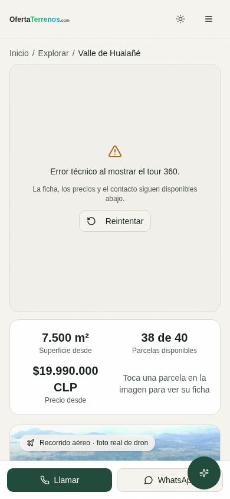
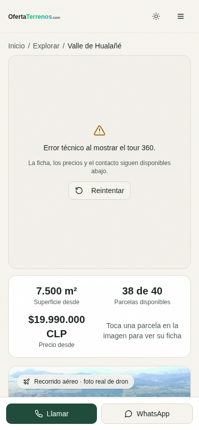
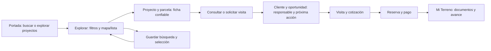

# Experiencia de plataforma: benchmark, brechas y próximos PR

Fecha: 29 de octubre de 2026. Base: `main` en `5eb9425b287d4894a8f0059526f5641557f19e89`, después de #221–223.

## Diagnóstico ejecutivo

La plataforma tiene buena cobertura funcional, pero todavía exige demasiado trabajo al usuario para encontrar una parcela, confiar en su ficha y continuar el proceso comercial. La prioridad es corregir información y acciones engañosas, facilitar búsqueda y retorno, y ordenar los dashboards por tareas.

Hay avances que se deben preservar: búsqueda textual en servidor, monedas explícitas, inventario por IDs, proyecto público unificado, formularios que conservan proyecto/lote, y separación de comprador, broker, empresa y plataforma. No hace falta empezar otra aplicación ni eliminar módulos solo porque tengan nombres parecidos.

Los hallazgos urgentes son verificables:

1. La ficha de Hualañé presenta **417.500 ha**, mientras el formulario almacena `total_area` en **m²**: 417.500 m² equivalen a **41,75 ha**.
2. El estado legal se puede elevar a “verificado” por ID/nombre de proyecto; otro badge cuenta documentos presentes como verificados, aunque estén pendientes.
3. “Activar alertas” no tiene acción en el panel del explorador. El chat del asistente flotante solo registra la consulta en consola y borra el texto.
4. Proyectos sigue mostrando ingresos estimados mediante `sold_lots * 25.000.000`. Los errores de CRM, reservas, visitas y del bloque “Hoy” no se resuelven de forma consistente.
5. A 320 × 740, el buscador de portada comienza en **y=759 px** y su botón en **y=815 px**: ambos requieren scroll. En 390 × 844, el botón termina aproximadamente en y=855 px.

## Alcance y método

- Revisión de rutas, navegación, portada, explorador, proyectos, contextos y dashboards sobre la base indicada.
- **11 recorridos anónimos en Chromium real**: siete base y cuatro dirigidos. Portada a 320/390/1440 px; explorador a 390 px; proyecto por alias y UUID; acceso sin sesión a comprador y administración.
- Navegación contra el build local de producción, con lecturas públicas de inventario. Sin crear cuentas, consultas, reservas, pagos ni cambiar roles o precios.
- POST bloqueados salvo la RPC pública de lectura `get_public_lots`. También se bloquearon las funciones de token Mapbox e imágenes Sentinel: los fallos de mapa/tour de esta prueba son condiciones inducidas, no incidentes de producción.
- WebGL deshabilitado deliberadamente para revisar continuidad comercial. No se evaluaron calidad del mapa, tour operativo, GPU, métricas de rendimiento de campo ni sesiones privadas reales. Google Fonts se bloqueó; no se juzga la carga real de tipografías.
- Las peticiones externas de lectura se canalizaron mediante curl con verificación TLS, conservando cabeceras como `Content-Range`. Los conteos finales del explorador no proceden de la primera sonda, que omitía esa cabecera y se descartó.
- Los assets relativos `__l5e` devuelven HTML en preview Vite y JPEG en el hosting canónico para la muestra comprobada. Cuatro recorridos dirigidos resolvieron esas imágenes desde el dominio canónico, sin modificar la aplicación. Esto permite distinguir portabilidad del build de un fallo en producción.

Evidencia: [resumen base](./audits/2026-10-29-experience/browser-summary.json), [recorridos con assets y alias](./audits/2026-10-29-experience/assets-and-route-summary.json), [comprobación de assets](./audits/2026-10-29-experience/asset-portability-check.json) y [fuentes del benchmark](./audits/2026-10-29-experience/benchmark-sources.json).

No se atribuyen porcentajes de pérdida de ventas ni aumentos de conversión sin analítica. Los hallazgos privados se identifican como revisión de código, no como pruebas autenticadas de RLS o permisos.

## Qué hacen bien las referencias y cómo adaptarlo

Se consultaron páginas oficiales que respondieron HTTP 200 en esta fecha. Son referencias de patrones, no una auditoría completa de competidores ni una reproducción de sus interfaces privadas.

| Referencia | Patrón observado | Aplicación a OfertaTerrenos |
|---|---|---|
| [Zillow](https://www.zillow.com/) | Búsqueda central y recomendaciones que explican el uso de ubicación, consultas, filtros y guardados. | Buscar primero y mostrar resultados comprensibles. Explicar las recomendaciones antes de añadir una puntuación opaca de IA. |
| [Rightmove](https://www.rightmove.co.uk/property-for-sale.html) | Buscar por lugar; guardar inmuebles, crear alertas y seguir consultas enviadas desde la cuenta. | Conectar búsqueda → guardado → alerta → consulta. Que el comprador pueda volver y saber qué ya consultó. |
| [Airbnb: wishlists](https://www.airbnb.com/help/article/1236) | Guardar, organizar y compartir alternativas; listas colaborativas con notas y votos. | Primero conservar la selección y comparación. La colaboración familiar puede venir después; no es necesaria para corregir el retorno básico. |
| [HubSpot: registros](https://knowledge.hubspot.com/records/work-with-records) | Una ficha con actividad, asociaciones y contexto comercial. | Reutilizar Clientes/LeadDetailSheet para unir consultas, visitas, cotizaciones y reservas; no crear un segundo CRM. |
| [HubSpot: espacio de ventas](https://knowledge.hubspot.com/prospecting/use-the-sales-workspace) | Trabajo diario mediante acciones priorizadas y reuniones. | El dashboard debe responder “qué hago hoy, para quién y en qué proyecto”, además de mostrar indicadores. |

Zillow y Rightmove son referencias inmobiliarias; Airbnb aporta decisión y retorno; HubSpot aporta operación comercial. Sus reglas legales, financiación y modelos de negocio no se trasladan automáticamente a parcelas chilenas.

LandWatch devolvió 403. Las URLs de ayuda de idealista probadas y dos URLs antiguas de Zillow/HubSpot devolvieron 404; no se usan para afirmar prestaciones ni ausencias de esas plataformas.

## Brechas comprobadas

Evidencia: **B** navegador; **C** código; **H** respuesta HTTP directa. P1 afecta confianza o una tarea principal; P2 afecta continuidad, claridad o capacidad operativa. No se ha demostrado un incidente P0.

| ID | Prioridad | Hallazgo | Evidencia y efecto |
|---|---|---|---|
| X01 | P1 | Unidad incorrecta de superficie total | **B+C**. `ProjectNarrative.tsx:25` agrega “ha” al valor sin convertir; `CreateProjectWizard.tsx:465` lo pide en m². Hualañé muestra 417.500 ha. Desorienta evaluación y comparación. |
| X02 | P1 | Verificación legal sin contrato de evidencia | **C**. `legalOverrides.ts:40–67` fija estados por ID o coincidencia “Licantén”, incluso sustituyendo datos pendientes. `VerificationBadge.tsx:23` usa longitud del array, sin filtrar estado ni deduplicar tipos. No determina si los documentos reales son válidos: demuestra que el indicador no exige esa evidencia. |
| X03 | P1 | Acciones presentadas como operativas no completan la tarea | **C**. Botón “Activar alertas” en `ExploreListPanel.tsx:679` sin handler/enlace. `AIFloatingButton.tsx:51` hace `console.log` y limpia el chat, sin respuesta. Sus accesos a herramientas terminan en el mismo `/tools` por aliases. |
| X04 | P1 | Fallo técnico puede parecer ausencia de negocio | **C**. LeadManagement no consume `error/refetch`; VisitsManager y ReservationsManager no muestran recuperación equivalente. `usePanelToday` no comprueba errores de respuestas y convierte conteos nulos a cero; TodayPanel puede afirmar “Todo contactado”. #215 cubre parte, no todo. |
| X05 | P1 | Métricas que significan otra cosa | **C**. ProjectsManagement calcula ingresos con un precio fijo de $25 millones por lote vendido. AdminUsers “Activos (7d)” usa actualización de perfil; errores de roles/planes pueden degradarse a arrays vacíos. No son ingresos ni actividad de sesión acreditados. |
| X06 | P1 | La búsqueda móvil queda relegada a la imagen | **B+C**. En 320 × 740, campo en y=759 y botón en y=815. La altura `62svh` precede al buscador. La propuesta aparece, pero la tarea principal queda debajo del primer viewport. |
| X07 | P1 | Filtros avanzados no tienen el mismo alcance que la búsqueda textual | **C**. Texto en servidor, pero tags/topografía/valoración/polígono filtran las páginas ya cargadas en Explorar. Esto requiere comunicar alcance o consultar el inventario completo; el total del servidor no describe necesariamente ese subconjunto. No se reabre el fallo antiguo de búsqueda textual. |
| X08 | P2 | El estado del explorador no se comparte ni restaura completo | **C**. URL sincroniza q/type/currency; presupuesto, superficie, región y otros filtros quedan en estado React. Compartir o recargar puede perder criterios. El carrusel de proyectos tampoco aplica el mismo filtro textual: mezcla ámbito “proyectos” con “parcelas”. |
| X09 | P1 | Una misma ficha cambia sus overlays según la URL | **B+C**. PublicLayout oculta asistente solo con prefijo `/proyecto/`. El alias `/valle-hualane` renderiza el mismo proyecto pero conserva el FAB encima de la zona de WhatsApp. La política debe depender del tipo de página, no del alias. |
| X10 | P2 | La ficha de proyecto repite presentación y navegación | **B+C**. Hualañé repite nombre y datos; combina tour superior, recorrido aéreo, hero, banda de modos y pestañas. El fallo inducido del tour mantiene 420 px antes de la información comercial. Dos headings iguales no prueban una penalización SEO; sí muestran repetición que dificulta orientarse. |
| X11 | P2 | Demasiadas puertas para una operación | **C**. 45 entradas declaradas mediante `agent(...)`, más rutas de publicación. No todas son visibles para todos los roles. Sidebar y ModulesHub repiten accesos y hay nombres próximos: Cierre/Cierres de venta/Ventas. AgentDashboard fija contexto empresa para el hub aunque el contexto actual puede conservarse como broker en rutas de asesor. Falta QA autenticado para medir el efecto. |
| X12 | P2 | La selección del comprador no sobrevive bien al retorno | **C**. El comparador mantiene hasta cuatro opciones solo en `useState`; se pierde al recargar. Existen favoritos, Alertas y Mi Terreno, pero el circuito guardar búsqueda → volver → revisar consulta no queda resuelto por su mera presencia. |
| X13 | P2 | Administración puede mostrar una visión parcial | **C**. AdminUsers carga listas sin paginación explícita, une roles/planes en cliente y deriva KPIs/CSV de lo recibido. Validar conteos y exportación con volúmenes por encima del límite del backend. No se afirma que la muestra actual de usuarios esté truncada. |
| X14 | P2 | Embudo público pendiente de inventario instrumental | **C**. `useTrackEvent` retorna sin usuario, aunque la exploración es pública. Existen atribución de campañas y formularios con proyecto/lote: conservarlos. Revisar otras vías de medición antes de añadir eventos; un clic WhatsApp no demuestra conversación o venta. |
| X15 | P2 | Preview/exportación dependen de un servicio de imágenes del hosting | **B+H**. Un asset `__l5e` respondió 200 HTML en preview y 200 JPEG en producción. No es un fallo probado de fotos publicadas; sí impide que el mismo build se revise de forma autónoma y exige definir el contrato de assets y fallback. |

La promoción de Licantén en portada contiene precio y condiciones escritos en el componente. Es un riesgo de desincronización que debe contrastarse con la fuente comercial; esta revisión no demuestra que la oferta vigente sea incorrecta.

## Lo que sí funcionó

- En los 11 recorridos no hubo overflow horizontal en los viewports revisados.
- La búsqueda “Valle” consultó inventario y mostró 107 resultados totales en la muestra final; 30 cargados no significa 30 en toda la plataforma. Los conteos son observaciones puntuales, no cifras permanentes.
- El proyecto siguió mostrando disponibilidad, precio y contacto cuando se impidió el tour/mapa.
- El botón de consulta abrió el diálogo tanto en el alias como en la ruta UUID, sin enviar formularios.
- Sin sesión, comprador y administración redirigieron a `/auth` conservando el destino.
- Las fotos de la muestra cargaron cuando se resolvió el servicio de assets canónico. No se declara una caída de imágenes en producción.

Las imágenes de proyecto muestran la prueba sin WebGL y con funciones de mapas bloqueadas. No son evidencia de un tour averiado en producción.

## Arquitectura de experiencia propuesta

Este recorrido reutiliza módulos y entidades existentes. Precio, stock y estado del lote deben coincidir en portada, explorador, plano, ficha, cotización y reserva.

| Persona | Navegación principal propuesta | Organización de lo demás |
|---|---|---|
| Visitante | Comprar, Proyectos, Vender, Ayuda | Herramientas como apoyo contextual; separar captación B2B de consulta de parcela. |
| Comprador | Inicio, Guardados, Comparar, Mis consultas/visitas, Mi Terreno | Reservas, documentos y cuotas dentro del recorrido existente; conservar selección y filtros al iniciar sesión. |
| Broker | Mi negocio, Proyectos en venta, Clientes, Visitas, Comisiones | Inventario propio y captaciones según permisos; tareas priorizadas antes que índice de herramientas. |
| Empresa | Hoy, Proyectos, Clientes/oportunidades, Agenda, Resultados | Plano, inventario, material y configuración dentro del proyecto. Pipeline como vista del CRM existente. |
| Plataforma | Pendientes, Proyectos/empresas, Usuarios, Operación, Auditoría | Acciones sensibles y métricas definidas; paginación y errores parciales visibles. |

Es una propuesta para probar con tareas y cuentas de staging. No autoriza eliminar módulos, cambiar roles/RLS ni renombrar todas las URLs. `/panel` sigue resolviendo contexto; los aliases y enlaces compartidos conservan proyecto, lote, campaña y pestaña.

## Plan de PR acotados

| Orden / PR propuesto | Brechas | Aceptación mínima |
|---|---|---|
| UX-01 · Unidades de ficha | X01 | Un contrato m²/ha; 417.500 m² se presenta como 41,75 ha o 417.500 m², nunca 417.500 ha. Sin alterar datos de inventario. Pruebas de cero, null y ambas unidades. |
| UX-02 · Evidencia de verificación | X02 | No aprobar por nombre/ID ni por presencia de un array. Contar tipos únicos con estado acreditado y evidencia definida; distinguir cargado, pendiente y verificado. Acordar fuente del registro de revisión antes de retirar una aprobación real. |
| UX-03 · Métricas comerciales honestas | X05 | Retirar el ingreso basado en precio fijo; usar transacciones o un indicador de inventario bien rotulado. Renombrar actividad basada en perfiles o usar una señal de actividad definida. |
| UX-04 · Recuperación de módulos | X04 | Actualizar la intención de #215 contra main; fallos de proyectos/CRM/visitas/reservas muestran error y reintento, no listas vacías. Validar cada módulo por separado si amplía el alcance. |
| UX-05 · Pendientes confiables | X04 | `usePanelToday` comprueba cada respuesta, comunica error parcial y evita “Todo contactado” si no pudo consultar. Cada acción lleva a su cola con filtro coherente. |
| UX-06 · Guardar búsqueda y alertas | X03, X08 | CTA operativo con filtros actuales; login conserva intención; confirmación y edición/pausa reales con el backend existente. Ninguna alta remota durante QA de producción. |
| UX-07 · Asistente y overlays de proyecto | X03, X09 | Suprimir la entrada de chat simulada o conectarla a una respuesta operativa autorizada. Botones con nombre accesible. La misma política de FAB para alias y UUID; WhatsApp queda utilizable a 320/390 px. |
| UX-08 · Portada móvil orientada a búsqueda | X06 | Propuesta, campo y CTA visibles a 320 × 740 y 390 × 844 con medios cargados, lentos o fallidos. Mantener globo/identidad y CTA B2B sin que bloqueen la tarea principal. |
| UX-09 · Alcance y retorno del explorador | X07, X08 | Separar implementación de filtros completos de serialización URL si requiere backend. Tags/topografía/polígono no prometen un total que solo corresponde a otra consulta; recargar y volver restaura criterios. Prueba con coincidencias fuera de la primera página. |
| UX-10 · Una cabecera por proyecto | X10 | Una identidad comercial, resumen de precio/stock y una navegación de modos. Tour/mapa opcionales y carga diferida; fallback compacto sin perder consulta, lote, campaña o reserva. |
| UX-11 · Dashboards por tarea y contexto | X11 | Probar comprador/broker/empresa/admin; cinco entradas principales orientativas por persona y una lista de próximas acciones. Sidebar y hub coherentes con contexto, permisos y plan. No eliminar funciones por parecido de nombres. |
| UX-12 · Retorno del comprador | X12 | Persistir IDs de comparación y revalidar precio/stock; continuidad con favoritos, consultas y visitas. Compartición colaborativa posterior, condicionada a uso. |
| UX-13 · Administración paginada | X13 | Filtros, conteos y CSV explícitos para todo el conjunto o solo la página. Error de roles/planes no se presenta como “sin rol/sin plan”. Fixtures por encima del límite de respuesta. |
| UX-14 · Assets y QA portable | X15 | Fuente de originales/derivados y ruta estable documentadas; preview con imágenes o adaptador explícito. No cambiar hosting ni asumir que las imágenes publicadas fallan. |
| UX-15 · Medición de experiencia | X14 | Inventario de eventos, atribución y privacidad; medir consulta confirmada, visita y reserva, no solo clicks. Línea base previa a experimentos. |

**Primera tanda recomendada:** UX-01, UX-02, UX-03 y UX-04. UX-08 y UX-07 siguen inmediatamente para mejorar la primera impresión y liberar la conversión móvil. Iniciar el inventario de medición en paralelo al diagnóstico, sin bloquear correcciones de hechos demostrados.

## Qué hacer con los PR abiertos

| PR | Decisión propuesta |
|---|---|
| [#215](https://github.com/alvarocumora/field-findr-ai/pull/215) | Prioridad funcional. Tiene conflictos; recuperar intención en UX-03/04, incorporando los contratos de tipos de #222–223. No cubre por sí solo el bloque Hoy. |
| [#217](https://github.com/alvarocumora/field-findr-ai/pull/217) | Relevante para tema oscuro, globo y fallback, pero conflictivo y de base anterior. Separar sus mejoras vigentes de UX móvil; validar contraste, reduced motion, assets y WebGL antes de integrar. |
| [#186](https://github.com/alvarocumora/field-findr-ai/pull/186) | La eliminación de Contacts/CRMSystem y aliases equivalentes ya existe en main. Comparar diff final y permisos para documentar sustitución; no restaurar páginas antiguas. |
| [#180](https://github.com/alvarocumora/field-findr-ai/pull/180), [#181](https://github.com/alvarocumora/field-findr-ai/pull/181) | Mantener los criterios de consulta/inventario sobre ProjectDetail unificado. No mezclar ni resucitar las landings Caone retiradas. |
| [#127](https://github.com/alvarocumora/field-findr-ai/pull/127) | Idea útil de shortlist, implementación acoplada a una landing antigua. Replantear en UX-12 con IDs canónicos; no es una solución lista para el comparador global. |
| [#145](https://github.com/alvarocumora/field-findr-ai/pull/145) | Revisar su pipeline de assets como insumo de UX-14. La auditoría no comprobó acceso al Drive ni migró archivos. |

No se cerraron ni fusionaron esos PR en esta revisión. Las validaciones antiguas no certifican compatibilidad con main actual. El bloqueo de facturación de Actions continúa según el diagnóstico previo; no se declara una nueva ejecución remota aprobada.

## Cómo comprobar que mejora

Antes de rediseñar todo, registrar tareas en staging: buscar una parcela por presupuesto; guardar y retomar; comparar dos opciones; consultar un lote; agendar visita; asignar una consulta; recuperar una carga fallida; identificar una reserva pendiente. Separar resultados por persona y móvil/escritorio.

Medir finalización de tareas, pérdida de contexto al volver, consultas confirmadas, tiempo hasta primera respuesta, visitas realizadas y reservas. Registrar errores de carga y recuperación. No se fijan mejoras porcentuales sin línea base ni se equiparan consultas con ventas.

La siguiente entrega de código debe cerrar un objetivo de esta lista con evidencia antes/después. Este PR es la auditoría y propuesta de experiencia: no modifica la aplicación, los datos ni los procesos comerciales.
